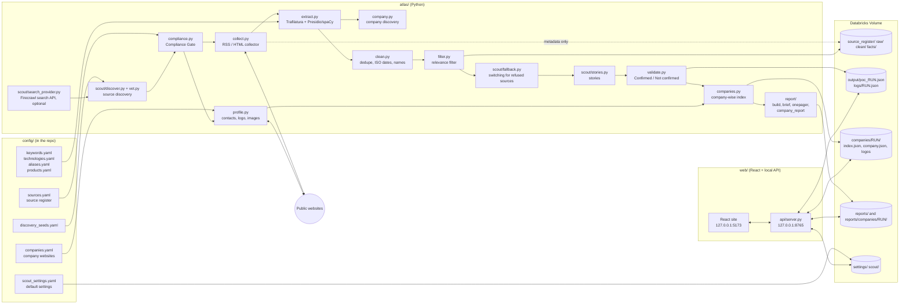
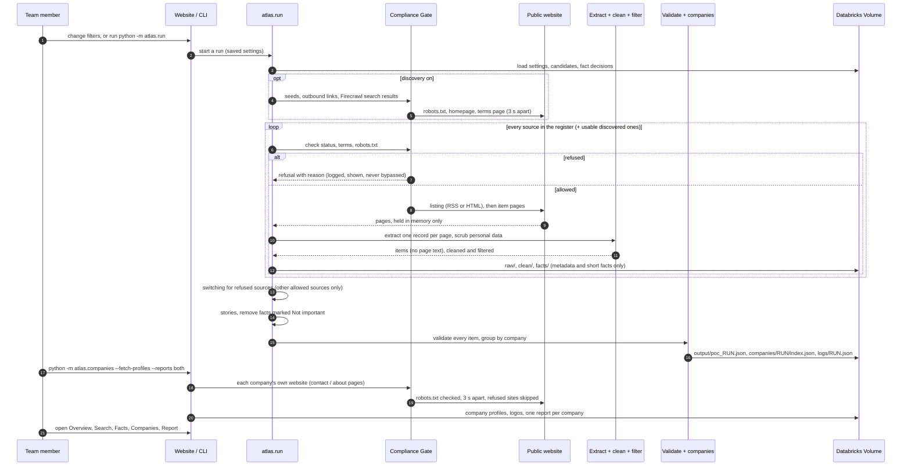

# Backend architecture and end-to-end workflow

This is the whole Market Scout backend after phase 3. The diagrams are Mermaid, so GitHub draws them; in VS Code
use a Mermaid preview extension.

## 1. Components

## 2. End-to-end workflow of one run

## 3. Stages, inputs and outputs

| Step | Module | Reads | Writes | Rule that matters most |
|---|---|---|---|---|
| 1 Gate | `compliance.py` | `sources.yaml`, robots.txt | refusals in the log | never fetch a refused site, 3 s between requests |
| 2 Discover (optional) | `scout/discover.py`, `vet.py`, `search_provider.py` | seeds, links, Firecrawl results | `scout/candidates.json` | a found source is never approved automatically |
| 3 Collect | `collect.py` | RSS feed or list page | `raw/` (metadata) | redirects re-checked, 429/503 stops the source |
| 4 Extract | `extract.py`, `company.py`, `htmlmeta.py` | page in memory | item fields | page text dropped, personal data scrubbed |
| 5 Clean | `clean.py` | items | `clean/` | dedupe by URL then fingerprint |
| 6 Filter | `filter.py` | items, settings | `facts/` | yes/no rules, every reason recorded |
| 7 Switch | `scout/fallback.py` | watchlist | `fallback_*` folders | other allowed sources only, labelled |
| 8 Stories | `scout/stories.py` | passed items | story ids | different companies never merged |
| 9 Validate | `validate.py` | items, stories, decisions | `validation` on each item | C1/C2/C3 criteria, blocks win |
| 10 Companies | `companies.py` | output | `companies/RUN/` | items without a company stay unattributed |
| 11 Profiles | `profile.py` | company websites | contacts, logo | company contacts only, role mailboxes only |
| 12 Reports | `report/*` | output, companies | `reports/` | numbers computed, text from templates |

## 4. Where each phase 3 task lives

| Task | Where |
|---|---|
| 1 Architecture and workflow | this file |
| 2 Company discovery | `atlas/company.py`, used by `atlas/extract.py` |
| 3 Content extraction | `atlas/extract.py` (`_main_text`, `page_headings`, `page_summary`, title and date fallbacks), `atlas/htmlmeta.py` |
| 4 Scraping tools | `docs/scraping_tools_evaluation.md`, `atlas/scout/search_provider.py` |
| 5 Blocked websites | research only: `docs/research_blocked_sites_and_agents.md` |
| 6 Company-wise classification | `atlas/companies.py`, Companies page |
| 7 Validation | `atlas/validate.py` |
| 8 Contacts and images | `atlas/profile.py`, `config/companies.yaml` |
| 9 Agentic approach | research only: `docs/research_blocked_sites_and_agents.md` |
| 10 Company reports | `atlas/report/company_report.py` |
