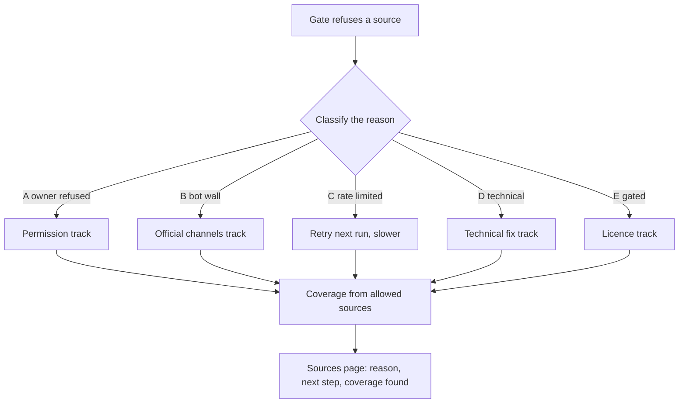
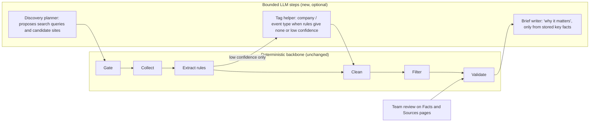

# Research: a pipeline for blocked websites (task 5) and an agentic approach (task 9)

Nothing in this file is built yet. It is a proposal for the team to discuss before any code changes.

---

## Part 1. Blocked, inaccessible and restricted websites (task 5)

### What "blocked" means today

The Compliance Gate already refuses a source and records why. In the last runs, 6 or 7 of 11 registered
sources were refused. The reasons fall into different groups, and each needs a different answer:

| Group | Typical reason code | Meaning | Can we ever read it? |
|---|---|---|---|
| A. Refused by the owner | `robots_disallow_listing`, `terms_forbid_automation` | The site says no to automated access | Only with permission |
| B. Bot wall | `http_403` from a WAF, CAPTCHA page | The site blocks unknown clients | Only through an official channel |
| C. Rate limited | `rate_limited_stop` (429/503) | Too many requests | Yes, later, more slowly |
| D. Technical | `robots_unreachable`, timeouts, `too_large`, JS-only pages | Not a refusal, the fetch failed | Yes, with a fix |
| E. Gated content | login or paywall | Content is for subscribers | Only with a licence |

### Principle

A refusal is a finding, not a problem to engineer around. The pipeline's job is to (1) say clearly why a
site was not read, (2) find the same information through channels that are allowed, and (3) ask for access
where it makes sense. It must never use stealth or residential proxies, CAPTCHA solvers, a spoofed browser
User-Agent, or archives, caches and translation proxies of the refused site (the fallback guard already
forbids the last group).

### Proposed pipeline

1. **Classify.** Map every refusal code to a group A to E and store it with the source (a new
   `blocked_reason_group` and `next_step` on the register row, or a `blocked/` folder in the Volume).
2. **Official channels (A, B, E).** Look for the same company's information where it is published for reuse:
   - **SEC EDGAR** for listed companies (Ingersoll Rand is NYSE-listed). It is free and keyless, has JSON
     endpoints on data.sec.gov, and asks for a declared User-Agent with a contact address and no more than
     10 requests per second. 8-K filings report acquisitions, leadership changes and results.
   - **GDELT DOC 2.0 API** for news mentions: free, no key, returns article title, link, domain, country and
     language. We would keep only links and run them through the gate like any candidate article.
   - The company's own RSS feed or sitemap, if robots.txt allows those paths even when the HTML pages are
     blocked.
   - Press-release wires that allow automated access (PR Newswire and Business Wire refused us, so this is
     a "check again" item, not an assumption).
3. **Coverage from allowed sources.** This exists already (switching, `via_fallback`). Extend it with the
   official channels above as extra fallback sources.
4. **Permission track (A).** Generate a short, polite email to the site's webmaster asking whether our
   identified bot may read the newsroom at one request every few seconds. Track it as `needs_permission`
   with a date. Atlas Copco may also hold licences to trade publications: that is open question 5 for them.
5. **Retry track (C, D).** Rate limits: try again on the next scheduled run with a longer delay, never
   within the same run. Technical failures: retry once with a longer timeout; for JavaScript-only pages
   whose robots.txt allows us, a headless browser (Playwright) that sends the same identified User-Agent
   and obeys the same gate. That is a rendering fix, not evasion.
6. **Re-check.** robots.txt and terms change. Re-check every refused site once a month and record the date.
7. **Show it.** The Sources page's Blocked tab shows the reason in plain words, the next step and what
   coverage was found elsewhere.

### Legal basis and the rules that keep it legal

This section is the team's reading of public case law and the data providers' own terms. It is not legal
advice. Atlas Copco's legal team should review it before anything here is built.

Two kinds of law matter for scraping.

The US anti-hacking law (CFAA). In hiQ v LinkedIn (9th Cir., April 2022) the court held that scraping pages
that are public, with no login or password, is likely not access "without authorization". The court read the
CFAA as an anti-intrusion law. The pipeline above never goes behind a login, a paywall or a block, so it stays
inside what that ruling allows.

Contract, through a site's terms of use. This is the bigger risk. hiQ won the CFAA point and still lost: in
November 2022 LinkedIn won summary judgment on breach of contract, and in December 2022 hiQ settled with a
permanent injunction to stop scraping and delete the code and data. Meta v Bright Data (N.D. Cal., January
2024) went the other way, but only because Meta's terms applied to logged-in users. Most courts have ruled
against scrapers who knew the terms forbade scraping. So a site whose terms forbid automated access is a hard
stop, which is what the Compliance Gate already does with `terms_forbid_automation`.

How each step of the pipeline stands:

| Step | Status | Condition |
|---|---|---|
| 1. Classify refusals | Allowed | Internal record only |
| 2. SEC EDGAR | Allowed | Declared User-Agent with a contact address, at most 10 requests per second |
| 2. GDELT DOC API | Allowed | GDELT allows any academic, commercial or government use of its data. That covers the links and metadata, not the articles: each article still goes through the gate for its own site |
| 2. Company RSS or sitemap | Allowed only if | robots.txt allows those paths and the terms do not forbid automated access |
| 3. Coverage from allowed sources | Allowed | Each source passes the gate on its own |
| 4. Permission emails | Allowed | Keep the written reply and record what was allowed (pages, rate) |
| 5. Rate-limit retry | Allowed | Next run only, slower, never IP rotation |
| 5. Playwright for JavaScript pages | Allowed only if | robots.txt and the terms both allow access. Never used to get past a block |
| 6. Monthly re-check | Required | Terms change; a site that allowed us may stop |

Rules the pipeline must follow:

1. Terms beat tools. If a site's terms forbid automated access we do not read it with any tool: our
   collector, Playwright or Firecrawl. Using a service to fetch the page does not move the responsibility.
2. No logins, paywalls, account credentials, stealth or residential proxies, CAPTCHA solving, spoofed
   User-Agents, or archive and cache copies of a refused page.
3. Store facts and links, not articles. Facts are not protected by copyright, article text and photos are.
   Reports keep short facts in our own words, the source link and images as links. Only the company logo is
   copied, for identification.
4. Personal data. Atlas Copco is in the EU, so GDPR applies, and India's DPDP Act may apply to the team's
   side. Keep role mailboxes only (info@, sales@), which the profile reader already does. Set a retention
   period for raw pages and a way to delete a company's data on request.
5. Identify ourselves. Keep the honest User-Agent with a contact address so a site owner can reach us.
6. Keep the gate's log of every allow and refuse decision. It is the record that we acted in good faith.

Questions for Atlas Copco's legal team: are GDELT and SEC EDGAR acceptable sources; how long may we keep
collected pages; is there a list of sites they want excluded; do they hold licences to trade publications we
could use.

### What to build first, if the team agrees

1. Reason classification and a "next step" column on the Blocked tab (small, no new network access).
2. SEC EDGAR fallback for listed companies on the watchlist (official API, clear rules).
3. GDELT news-mention fallback (links only, gated like everything else).
4. Monthly re-check and the permission tracker.

---

## Part 2. An agent-based or hybrid architecture (task 9)

### Workflows or agents

Anthropic's guidance draws a line between **workflows**, where LLM calls and tools follow code paths we
wrote, and **agents**, where the model decides its own steps and tool use. Their advice is to start with
the simplest thing that works and add agent behaviour only where it clearly pays off, because agents trade
cost and predictability for flexibility.

Market Scout is a good fit for that advice. Most of it (compliance, collection, filtering, storage,
reports) must be predictable and auditable, so it stays deterministic code. The weak spots are the
judgement calls where our rules return nothing or a low-confidence answer.

### Proposed hybrid

1. **Tag helper (routing).** Only when `company_confidence` is low or `event_type` is "other", send the
   *scrubbed* title, headings and key facts (never full page text) to the model and ask for a company and
   event type with a quoted phrase as evidence. If the quote is not in the input, discard the answer. The
   item records `company_method: "llm"` and stays Not confirmed until a rule or a person confirms it.
2. **Discovery planner (orchestrator).** The model proposes search queries and candidate sites for a topic.
   It can only call our tools: `search_api`, `gate_check`, `vet_candidate`. It never makes raw HTTP calls,
   so it cannot get around robots.txt. Candidates still need a human decision.
3. **Brief writer (evaluator check).** Writes the "why it matters" line from stored key facts; a second check
   rejects any sentence with a number or name that is not in those facts.
4. **Human in the loop.** The Facts and Sources pages already hold the team's decisions; LLM output never
   sets Confirmed on its own.

### Guardrails

- Personal data scrubbed before any LLM call; no page text sent or stored.
- A fixed tool list, a request and token budget per run, and every call logged.
- Same compliance rules for the agent as for the code: the agent has no fetch tool of its own.
- Measured, not assumed: run rules-only and hybrid on the hand-check set (docs/check_results_phase2.md) and
  compare accuracy, cost and run time before switching anything on.

### Tools to build it with

Start with the model's API and tool use directly (as Anthropic recommends) rather than a framework. If the
flow grows, LangGraph or the Model Context Protocol can wrap the same tools. ScrapeGraphAI's agentic scraper
is an option for the tag helper experiment, but only on pages the gate already allowed.

### A decision the team must make first

Our documents and slides say the system is rule-based and the report text is templated, "no AI". Adding
LLM steps changes that statement, so the team (and Atlas Copco) should agree before it is built, and the
report should then mark which fields came from a model.

---

## Sources

- [hiQ v. LinkedIn wrapped up: web scraping lessons learned (ZwillGen)](https://www.zwillgen.com/alternative-data/hiq-v-linkedin-wrapped-up-web-scraping-lessons-learned/)
- [Ninth Circuit reaffirms narrow reading of the CFAA in hiQ v. LinkedIn (Haynes Boone)](https://www.haynesboone.com/news/publications/ninth-circuit-rejects-linkedin-attempt-to-prevent-web-scraping-of-publicly-member-profiles)
- [LinkedIn v. hiQ settlement and the contract risk (Morgan Lewis)](https://www.morganlewis.com/blogs/sourcingatmorganlewis/2022/12/linkedin-v-hiq-landmark-data-scraping-suit-provides-guidance-to-data-scrapers-and-web-operators)
- [Meta v. Bright Data summary judgment (Farella Braun + Martel)](https://www.fbm.com/data-analytics/publications/major-decision-affects-law-of-scraping-and-online-data-collection-meta-platforms-v-bright-data/)
- [Judge sides against Meta over scraping public data (MediaPost)](https://www.mediapost.com/publications/article/392920/bright-data-didnt-violate-metas-terms-by-scrapin.html)
- [GDELT terms of use](https://www.gdeltproject.org/about.html)
- [Building effective agents (Anthropic)](https://www.anthropic.com/engineering/building-effective-agents)
- [Accessing EDGAR data: fair access, User-Agent, 10 requests per second (SEC)](https://www.sec.gov/os/accessing-edgar-data)
- [SEC developer resources](https://www.sec.gov/developer)
- [GDELT DOC 2.0 API announcement](https://blog.gdeltproject.org/gdelt-doc-2-0-api-debuts/)
- [GDELT DOC 2.0 API client (gdeltdoc)](https://libraries.io/pypi/gdeltdoc/1.8.0)
- [Firecrawl stealth / proxy modes (what we will not use)](https://docs.firecrawl.dev/features/stealth-mode)
- [What is agentic scraping (ScrapeGraphAI)](https://scrapegraphai.com/glossary/ai-scraping/agentic-scraping)
